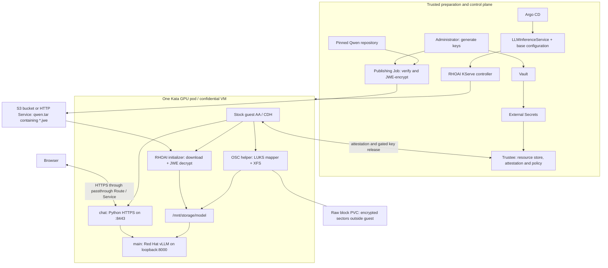

# Architecture and execution: encrypted model to confidential browser chat

This describes `rhoai-confidential-qwen`. Repository-relative source links follow
the revision of this document; open it at a commit to retain that exact source
and its line numbers. External product source links are commit-pinned.
RHOAI is **3.6.0-ea.2**, OSC **1.13.1**,
and Trustee **1.2.1**. This documents the deployed preview integration, not a
blanket claim of production support; the initializer derivative and demo glue
are custom.
Image digests are pinned in [workload values][images], [publisher values][publisher-values]
and [build provenance][provenance].
Product context is in the [Red Hat confidential-serving guide](https://access.redhat.com/articles/7149016);
the [integration inventory](integration-boundary.md) explains adaptations of the shared reference.

Product source revisions come from the pinned images' OCI labels: RHOAI KServe
`1e9ee7f8ca3decf684980f70a2757f28d3e0b0fd` and OSC storage helper
`617f70ce2225e036976c94783e1812a1dec4e41c`. The serving CRD schema comparison
below was performed against the installed cluster on 20 October 2026.

**There are three separate cryptographic layers:** JWE encrypts the distributed
model files; guest-side LUKS encrypts persistent block storage; the chat server's
TLS encrypts browser traffic. The model archive is not an encrypted OCI image.
RHOAI's initializer decrypts model files; CDH/Trustee deliver the key; OSC opens
the disk; vLLM consumes ordinary plaintext files inside the confidential VM.



## 1. Install the owners; prepare the model-specific inputs

The stock CoCo pattern supplies OSC/Kata, GPU configuration, Trustee, Vault/ESO
and storage. Our [ClusterGroup extension][applications] adds three Argo
Applications: `rhoai-platform`, `rhoai-model-publisher`, and
`rhoai-confidential-qwen`. The optional `rhoai-object-storage` application
installs the ODF standalone MCG resources described in [the S3 runbook](s3.md).
NFD discovers hardware; the NVIDIA GPU Operator configures GPU passthrough.
ACM policies distribute CoCo configuration and Trustee reference values.
The ordinary CoCo Kyverno policies remain present; this workload supplies its
own measured initdata and sets `coco.io/skip-initdata: "true"`.

`rhoai-platform` declares the RHOAI OLM [Subscription][subscription] and a
[`DataScienceCluster`][dsc] with KServe `Managed`; dashboard, workbenches and
unneeded services are `Removed`. Our [bootstrap hook][bootstrap] approves only
the pinned initial InstallPlan and waits for the product's CRDs/readiness.
The RHOAI operator installs the serving controllers and CRDs. We consume those
APIs; we do not implement a serving controller.

Administrator preparation remains explicit: [build][build-command] the
initializer derivative, [enroll][enroll-keys] keys, [publish][publish-command]
the model, and [prepare][prepare] the measured guest policy.
`rhoai-configure-owner.sh ready` [copies public values and enables the applications][activate];
commit/push activates GitOps. Secret bytes stay out of Git.
The OpenShift internal image registry stores the derivative initializer image;
it is separate from the HTTP service or S3 bucket storing encrypted model artifacts.

## 2. Generate and distribute the keys

[`rhoai-enroll.sh:15–32`][enroll-keys] generates:

| Material | Representation and consumer |
|---|---|
| Model wrapping key | 32 random bytes; `model-key.bin` for KBS and equivalent symmetric JWK `model-key.json` for the publisher |
| LUKS passphrase | Independent 32 random bytes represented as 64 hexadecimal characters; supplied to `cryptsetup` through the OSC helper |
| Chat TLS material | Separate CA and server key/certificate, generated by [the certificate block][enroll-tls] |
| Registry credentials | Red Hat registry access plus a namespace-scoped internal-registry pull token, assembled by [enrollment][enroll-registry] |

The helper writes Base64-encoded values to Vault's `secret/hub/rhoaiQwen`;
it [refuses implicit replacement of existing model/LUKS keys][enroll-vault].
The [CoCo secret configuration][secret-config] and
[`ExternalSecret` template][eso] decode these into the Trustee-side
`rhoai-qwen-secrets` Kubernetes Secret. Trustee's stock `secret-converter`
copies the resources into its memory-backed repository when its pod starts.
Updating the Secret alone does not reload that copy; see the
[documented rotation sequence](install.md#renew-chat-certificates-and-reload-trustee-resources).

The workload receives identifiers, not model/LUKS/TLS secret mounts:
`kbs:///default/rhoai-qwen-secrets/{model-key,luks-passphrase,tls-cert,tls-key,registry}`.
Here `default` is the repository, `rhoai-qwen-secrets` the resource type and the
last segment the tag. Publisher preparation is different: the trusted Job
receives the JWK through a normal Kubernetes Secret mounted at `/keys`.

## 3. Encrypt and publish Qwen

The trusted [`publish-qwen` Job][publisher-job] runs the **unchanged RHOAI
storage-initializer image**, with our mounted publishing script. It is an
ordinary preparation pod, outside the confidential serving VM.

[`publish.sh`][publish-script] invokes the product initializer to download
`hf://Qwen/Qwen3-0.6B:c1899de289a04d12100db370d81485cdf75e47ca`,
checks [eight pinned SHA-256 entries][model-inventory], and copies only that
inventory: weights, tokenizer/configuration files and license. It then calls
the [encryption utility][encrypt] vendored unchanged from
[Yuval's pinned reference][reference].

For **each file**, the encryptor generates a random 256-bit content encryption
key (CEK) and 96-bit IV. AES-256-GCM encrypts the contents; AES-256 Key Wrap
wraps that CEK with the shared model wrapping key. The Base64URL-encoded
protected header (`alg=A256KW`, `enc=A256GCM`) is authenticated as GCM AAD.
The resulting compact JWE is
`header.wrapped-CEK.IV.ciphertext.tag`, written as `<original-name>.jwe`.
The utility streams plaintext in 8 MiB chunks and publishes each result using
a temporary-file rename. See [encryption and serialization][encrypt].

Our wrapper packages only `*.jwe` into `/data/public/qwen.tar` and removes its
plaintext staging directories. The [HTTP Deployment and Service][publisher-http]
serve that directory on port 8080. The model URI is
`http://encrypted-model.rhoai-model-publisher.svc:8080/qwen.tar`.
The tar container and filenames are visible; file contents are encrypted.
This is the default HTTP mode. In S3 mode, the [upload helper][s3-upload]
uploads the same archive to a unique `s3://bucket/qwen3-0.6b/release/qwen.tar`,
checks size/metadata and reads the object back to verify its SHA-256. Only then
does [preparation][prepare] accept that URI for activation. The publication Job
uses a temporary PVC; no HTTP Deployment or Service is rendered. Neither mode
is an OCI model-image pull.

For ODF, [stock API resources][odf-resources] provision MCG, its PVC-backed store,
bucket and two accounts. Our [policy hook][odf-policy] gives the publisher
write/read and the initializer read access to the ciphertext prefix.
[Enrollment][s3-enroll] stores distinct SDK credential files in Vault;
[External Secrets][s3-reader] mounts only the reader file into the initializer.
The OBC bucket-owner credential is restricted to the policy Job. S3 credentials
are not model keys and do not require attestation; Trustee still gates decryption.
Endpoint/region and mount paths enter the measured profile; a private S3 CA is
copied into guest memory and hash-verified by [measured startup][verified-copy].

The publisher and its storage are trusted: plaintext exists there during
preparation, and ordinary file deletion is not secure erasure of its PVC.
Only ciphertext is exposed by the HTTP document root.

## 4. Tell RHOAI what to create

[`serving.yaml`][llm] creates exactly one
`serving.kserve.io/v1alpha2` **`LLMInferenceService`**, named `qwen`.
It references `coco-encrypted-storage`, an
[`LLMInferenceServiceConfig`][base-config] containing the pod template.
It does not also create a generic `InferenceService` or a `ServingRuntime`.

```yaml
spec:
  baseRefs:
    - name: coco-encrypted-storage
  model:
    name: qwen3-0.6b
    uri: s3://MODEL_BUCKET/qwen3-0.6b/RELEASE_ID/qwen.tar
    confidential:
      enabled: true
      resourceId: kbs:///default/rhoai-qwen-secrets/model-key
```

This shows S3 mode; HTTP mode uses the publisher URL described above.
The controller resolves the base configuration and creates the serving
Deployment/Pod (`qwen-kserve` in this installation).
The product schemas are [LLMInferenceService][llm-crd] and
[LLMInferenceServiceConfig][config-crd]; the exact
[`model.confidential` schema][confidential-schema] requires an object containing
`enabled`, not a scalar `confidential: true`. Both installed `v1alpha2`
OpenAPI schemas were compared with this pinned source and matched.

**Automatic initializer injection is disabled** by
`storageInitializer.enabled: false` in the base configuration. We explicitly
declare the initializer after disk preparation and explicitly supply
`CONFIDENTIAL_ENABLED=true`, `CONFIDENTIAL_RESOURCE_ID`, and `MODEL_URI`
([explicit template][initializer-template]).
Thus the declarative model flag and the actual initializer environment agree;
the flag alone does not wire this custom ordered template.

## 5. Start and attest one confidential VM

The pod requests `runtimeClassName: kata-cc-nvidia-gpu`; the CoCo hardware
profile selects its SNP or TDX handler. The template uses a shared process
namespace and requests one `nvidia.com/pgpu` passthrough GPU for `main`.
Its [annotations][llm] supply VM dimensions and compressed initdata.
The generic dimensions are eight vCPUs and 65,536 MiB.

[`rhoai-prepare.sh`][prepare] renders the exact image digests, commands,
environments and mount destinations into a guest policy, combines it with
stock AA/CDH configuration, computes the initdata SHA-256, and generates the
Trustee binding. The guest pulls application images using registry credentials
resolved through KBS ([CDH image configuration][prepare-cdh]).
Container images are digest-pinned, not encrypted by this demo.
The application service account has token automount disabled; the chat process
does not use Kubernetes credentials to serve a request.

Stock guest AA/CDH and Trustee perform attestation/key delivery. Our
[resource policy][key-policy] requires Affirming CPU/GPU appraisals, the exact
initdata, and selected CPU measurements: SNP launch measurement or TDX
MRTD/RTMR1/RTMR2. GPU secure boot must be enabled, debug disabled and measurement
validation successful. [RVPS configuration][rvps] registers the expected
references. The model, disk, TLS and registry resources share this guest binding.

Our [guest policy][guest-policy] restricts container creation and denies
interactive exec and policy replacement. The [startup command generator][verified-copy]
copies scripts/UI from ConfigMaps into `/dev/shm/verified-<role>`, verifies
their SHA-256 inventory embedded in the measured command, and executes that
copy. This protects execution from later changes to the host-provided ConfigMap.
AA/CDH and the Kata agent are guest services, not extra application sidecars.

## 6. Open the encrypted disk before downloading

The actual application container sequence is:

| Stage/name | Artifact | Work |
|---|---|---|
| `format-disk` | Stock Red Hat `osc-storage-helper` + our `format.sh` | Native restartable init sidecar (`restartPolicy: Always`); opens/mounts the disk and stays alive |
| `check-ready` | Same stock OSC image | Ordinary init container; runs `luks-helper wait-ready` |
| `storage-initializer` | RHOAI image with one upstream module replaced | Ordinary init container; mounts the open filesystem, downloads/decrypts/checks the model, exits |
| `main` | Unchanged Red Hat AI Inference Server vLLM image | Loads Qwen and serves inference |
| `chat` | Unchanged Red Hat UBI Python image + custom application | Fetches TLS material, serves UI and proxies chat to vLLM |

These are [declared together][pod-containers] in one pod and one confidential
VM. There is no KServe controller container beside the chat container.

The [PVC][pvc] is `volumeMode: Block`, `ReadWriteOncePod`, retained across pod
deletion. The helper receives it as `/dev/block-device`.
[`format.sh`][format] gets the passphrase from guest-local
`http://127.0.0.1:8006/cdh/resource/default/rhoai-qwen-secrets/luks-passphrase`.
For existing LUKS it tests the key; for a new device it checks signatures and
a blank initial header region. It then executes the **stock**
`/usr/local/bin/luks-helper format-disk`.

The [Red Hat helper implementation][osc-helper] calls `cryptsetup luksFormat`
only when needed, `luksOpen`, `mkfs.xfs` when needed, and mounts
`/dev/mapper/mapper` at `/mnt/storage`. It uses cryptsetup's defaults rather
than cipher/KDF parameters supplied by our wrapper. It publishes its PID and
`.ready` marker and remains alive; [the readiness helper][osc-ready] waits for
that marker.

Container mount namespaces are distinct. Our [`link.sh`][mount-glue] locates
the helper via `/dev/shm/luks-helper.pid` and mounts its already-open mapper,
`/proc/<pid>/root/dev/mapper/mapper`, as XFS at `/mnt/storage` in each consumer.
It uses Python `ctypes` to call Linux `mount(2)` because the initializer lacks
`mount(8)`. It does not unlock the disk or decrypt the model.
This replaces the reference's cross-container symlink, which did not work
with Python archive path validation. The helper, initializer and vLLM require
guest privilege for this preview integration.

## 7. Download, decrypt, and present ordinary model files

[`initialize.sh`][initialize] creates `model`, `cache` and `tmp` on the mounted
encrypted filesystem, redirects scratch/cache paths there, and invokes:

```sh
/storage-initializer/scripts/initializer-entrypoint "$MODEL_URI" /mnt/storage/model
```

The [unchanged product entrypoint][product-entry] calls `Storage.download_files`,
then, when `CONFIDENTIAL_ENABLED=true`, constructs `CDHSecretResolver` and
`JWEDecryptor` and calls `decrypt_directory`.
The [product HTTP/archive code][product-http] downloads the tar, extracts it
with `filter="data"`, and removes the tar. For S3, the [same product
storage library][product-s3] first probes the bucket, lists the selected prefix,
downloads the exact tar using boto3 and then uses that extraction path.
The explicit template configures path-style addressing, region, endpoint and
credential-file path, with TLS verification enabled. `AWS_CA_BUNDLE` points to
the measured in-memory CA copy when a private CA is selected.
[`CDHSecretResolver`][cdh-resolver] resolves the KBS URI through port 8006 and
returns key bytes. **Decryption runs in the initializer's Python process
inside the VM**; neither Trustee nor vLLM decrypts the model JWE.

Our [five-line Dockerfile][dockerfile] replaces only
`kserve_storage/confidential/jwe_decryptor.py` with the checksum-pinned module
from [upstream PR 6219][streaming-pr]. That module unwraps each CEK, streams
Base64URL/GCM processing in 1 MiB encoded chunks, writes a temporary plaintext
file beside the destination, verifies the GCM tag, then renames it and removes
the `.jwe` source ([streaming/authentication][decrypt-stream],
[promotion and key loading][decrypt-promote]). On authentication failure it
removes the temporary file and does not replace the previous destination.

The wrapper verifies all eight plaintext hashes before creating `.complete`.
Files now appear normally as `/mnt/storage/model/model.safetensors`,
`config.json`, tokenizer files, etc. Reads return plaintext inside the guest;
the guest's dm-crypt layer encrypts block writes before they reach the host PVC.
vLLM caches and initializer scratch also use that filesystem.

On VM replacement, the new guest must attest and obtain the LUKS key again.
If `.complete` and every pinned hash match, the wrapper skips both download
and JWE decryption; the model wrapping key is not needed for this reuse path.
The new vLLM process still loads the weights into GPU memory.
Streaming reduces RAM pressure; it does not eliminate simultaneous
ciphertext/plaintext disk space or change the preview's published support limits.

## 8. Serve Qwen and complete a browser request

[`vllm.sh`][vllm] mounts and rechecks the model, enables offline model access,
and starts the unchanged server with:
`--model /mnt/storage/model --served-model-name qwen3-0.6b`,
`--host 127.0.0.1 --port 8000`, BF16, context length 2048, four concurrent
sequences, GPU utilization 0.25 and eager execution.
The [template][vllm-template] supplies guest CUDA library settings; the optional
site attention backend is separate from the generic H100 configuration.

The chat application is ConfigMap-delivered [HTML/JavaScript and Python][chat-config],
copied and hash-verified as above. It runs in a **separate `chat` container
beside `main` in the same VM**, using the stock UBI Python interpreter.
[`chat.sh`][chat-start] fetches the TLS certificate/key through CDH into
`/dev/shm/chat-tls`, waits for vLLM `/health`, imports `server.py`, and starts
`ThreadingHTTPServer` wrapped in `ssl.SSLContext` on `0.0.0.0:8443`
(minimum TLS 1.2). The standalone HTTP `__main__` block in `server.py` is not
the entrypoint used here.

The [OpenShift Route][route] is **TLS passthrough**:
browser `:443` → router → Service `:443` → pod `:8443`.
The Python server inside the VM terminates TLS; the router has no chat private
key. The browser trusts the demo CA, an organization CA, or an explicitly
accepted certificate exception. It does not itself run an attestation verifier;
Trustee gates release of the TLS key.

[`index.html`][browser-code] POSTs `{messages: [...]}` to same-origin `/api/chat`.
The [Python handler][proxy] checks origin, JSON shape and request size, then
POSTs to `http://127.0.0.1:8000/v1/chat/completions` with the model name,
`max_tokens: 256`, `stream: false`, and `enable_thinking: false`.
It returns the OpenAI-style JSON response over the browser TLS connection;
JavaScript displays `choices[0].message.content`.
History remains in tab memory, with bounded context sent per request.
There is no external inference gateway, RHOAI API-auth path or chat login;
this is an internal-network demo endpoint. `/healthz` checks the loopback
vLLM health endpoint and is used by both containers' probes.

## 9. Product boundary and glue-code inventory

| Component | Origin / responsibility |
|---|---|
| OpenShift GitOps, OLM, Route/Service, storage APIs | Red Hat platform functionality; our Helm values/resources configure it |
| NFD, ACM, External Secrets, CoCo admission policies | Discover hardware, reconcile configuration/references, synchronize keys and apply admission policy; existing platform/pattern dependencies |
| NVIDIA GPU Operator and GPU driver/firmware | NVIDIA components supplying the GPU path; consuming them through the pattern does not make them Red Hat-authored artifacts |
| OSC/Kata, guest AA/CDH, `osc-storage-helper` | Red Hat CoCo artifacts; VM isolation, guest image pull, attestation integration and LUKS lifecycle |
| Red Hat build of Trustee | Product key broker/appraisal/resource service; our references and Rego decide which guest receives keys |
| Optional Red Hat ODF MCG | Product S3 gateway, bucket, accounts and PVC-backed ciphertext storage |
| RHOAI operator/KServe, storage initializer | Product API reconciliation, download/extraction, CDH key resolution and confidential decryption orchestration |
| Initializer decryptor replacement | Vendored upstream KServe fix in a custom derivative; not an unchanged Red Hat supported image |
| Red Hat AI Inference Server / UBI Python | Unchanged Red Hat runtime images; vLLM serves inference, Python hosts our application |
| Qwen weights; JWE encryption utility | Qwen upstream model; utility from Yuval's reference, not a Red Hat encryption service |
| Vault and Validated Pattern charts | Existing pattern dependencies/configuration; not RHOAI model-serving features |

Our glue is: the RHOAI dependency hook; publisher wrapper/HTTP manifests;
S3 upload/readback, credential enrollment and the ODF bucket-policy hook;
enrollment and measured-policy preparation scripts; Helm pod/volume/Route
wiring; guarded disk-format, mount, initializer-reuse and vLLM-start wrappers;
guest/Trustee policies; and the imported/adapted chat frontend, proxy and TLS
startup. The complete file-by-file inventory is in
[integration-boundary.md](integration-boundary.md#added-and-reused-code-inventory).
The encryptor and streaming decryptor are reused upstream code, not algorithms
we invented. We add no custom storage operator, CSI driver or model populator.

All containers inside this VM belong to one trusted workload; shared guest
storage/process access is not isolation between the chat and inference code.
Trustee, the publisher and their administrators remain trusted outside the VM.
LUKS alone is not a general integrity/rollback guarantee; JWE authentication
and the pinned model inventory protect model acceptance. Hardware qualification
and the intervention-free-install result are separate from this execution
trace; see the [test-site acceptance record](../../testing/cluster-01/README.md#recorded-clean-installation).

[images]: ../../charts/coco-supported/rhoai-confidential-qwen/values.yaml#L21-L28
[publisher-values]: ../../charts/hub/rhoai-model-publisher/values.yaml#L1-L5
[provenance]: ../../build/storage-initializer/provenance.json#L1-L8
[applications]: ../../overrides/values-rhoai.yaml#L19-L92
[subscription]: ../../charts/hub/rhoai-platform/templates/operator.yaml#L17-L32
[dsc]: ../../charts/hub/rhoai-platform/templates/components.yaml#L1-L45
[bootstrap]: ../../charts/hub/rhoai-platform/files/bootstrap.py#L58-L101
[build-command]: ../../scripts/rhoai-demo.sh#L58-L70
[enroll-keys]: ../../scripts/rhoai-enroll.sh#L15-L32
[publish-command]: ../../scripts/rhoai-demo.sh#L72-L113
[prepare]: ../../scripts/rhoai-prepare.sh#L25-L102
[activate]: ../../scripts/rhoai-configure-owner.sh#L18-L34
[enroll-tls]: ../../scripts/rhoai-enroll.sh#L34-L76
[enroll-registry]: ../../scripts/rhoai-enroll.sh#L77-L114
[enroll-vault]: ../../scripts/rhoai-enroll.sh#L129-L145
[secret-config]: ../../overrides/values-rhoai-qwen-trustee.yaml#L1-L11
[eso]: ../../charts/hub/rhoai-trustee/templates/dynamic-eso.yaml#L1-L25
[publisher-job]: ../../charts/hub/rhoai-model-publisher/templates/resources.yaml#L29-L131
[publish-script]: ../../charts/hub/rhoai-model-publisher/files/publish.sh#L1-L18
[model-inventory]: ../../charts/hub/rhoai-model-publisher/files/model.sha256#L1-L8
[encrypt]: ../../charts/hub/rhoai-model-publisher/files/encrypt_model.py#L90-L153
[publisher-http]: ../../charts/hub/rhoai-model-publisher/templates/resources.yaml#L133-L181
[llm]: ../../charts/coco-supported/rhoai-confidential-qwen/templates/serving.yaml#L188-L216
[base-config]: ../../charts/coco-supported/rhoai-confidential-qwen/templates/serving.yaml#L1-L35
[initializer-template]: ../../charts/coco-supported/rhoai-confidential-qwen/templates/serving.yaml#L77-L116
[prepare-cdh]: ../../scripts/rhoai-prepare.sh#L92-L102
[key-policy]: ../../charts/hub/rhoai-trustee/files/resource-policy.rego#L82-L127
[rvps]: ../../charts/hub/rhoai-trustee/templates/rvps-values-policies.yaml#L21-L39
[guest-policy]: ../../policies/rhoai-guest.rego.in#L1-L18
[verified-copy]: ../../charts/coco-supported/rhoai-confidential-qwen/templates/_helpers.tpl#L1-L29
[pod-containers]: ../../charts/coco-supported/rhoai-confidential-qwen/templates/serving.yaml#L45-L186
[pvc]: ../../charts/coco-supported/rhoai-confidential-qwen/templates/resources.yaml#L22-L36
[format]: ../../charts/coco-supported/rhoai-confidential-qwen/files/format.sh#L1-L31
[mount-glue]: ../../charts/coco-supported/rhoai-confidential-qwen/files/link.sh#L1-L32
[initialize]: ../../charts/coco-supported/rhoai-confidential-qwen/files/initialize.sh#L1-L25
[dockerfile]: ../../build/storage-initializer/Dockerfile#L1-L5
[decrypt-stream]: ../../build/storage-initializer/jwe_decryptor.py#L223-L272
[decrypt-promote]: ../../build/storage-initializer/jwe_decryptor.py#L345-L427
[vllm]: ../../charts/coco-supported/rhoai-confidential-qwen/files/vllm.sh#L1-L19
[vllm-template]: ../../charts/coco-supported/rhoai-confidential-qwen/templates/serving.yaml#L118-L156
[chat-config]: ../../charts/coco-supported/rhoai-confidential-qwen/templates/resources.yaml#L38-L56
[chat-start]: ../../charts/coco-supported/rhoai-confidential-qwen/files/chat.sh#L1-L24
[route]: ../../charts/coco-supported/rhoai-confidential-qwen/templates/resources.yaml#L58-L87
[browser-code]: ../../charts/coco-supported/rhoai-confidential-qwen/files/index.html#L21-L50
[proxy]: ../../charts/coco-supported/rhoai-confidential-qwen/files/server.py#L13-L55
[llm-crd]: https://github.com/red-hat-data-services/kserve/blob/1e9ee7f8ca3decf684980f70a2757f28d3e0b0fd/config/crd/full/llmisvc/serving.kserve.io_llminferenceservices.yaml#L25355-L25383
[config-crd]: https://github.com/red-hat-data-services/kserve/blob/1e9ee7f8ca3decf684980f70a2757f28d3e0b0fd/config/crd/full/llmisvc/serving.kserve.io_llminferenceserviceconfigs.yaml#L24750-L24780
[confidential-schema]: https://github.com/red-hat-data-services/kserve/blob/1e9ee7f8ca3decf684980f70a2757f28d3e0b0fd/config/crd/full/llmisvc/serving.kserve.io_llminferenceservices.yaml#L25520-L25530
[product-entry]: https://github.com/red-hat-data-services/kserve/blob/1e9ee7f8ca3decf684980f70a2757f28d3e0b0fd/python/storage-initializer/scripts/initializer-entrypoint#L25-L64
[product-http]: https://github.com/red-hat-data-services/kserve/blob/1e9ee7f8ca3decf684980f70a2757f28d3e0b0fd/python/storage/kserve_storage/kserve_storage.py#L1624-L1718
[cdh-resolver]: https://github.com/red-hat-data-services/kserve/blob/1e9ee7f8ca3decf684980f70a2757f28d3e0b0fd/python/storage/kserve_storage/confidential/cdh_client.py#L52-L85
[osc-helper]: https://github.com/openshift/confidential-compute-artifacts/blob/617f70ce2225e036976c94783e1812a1dec4e41c/containerfiles/storage-helper/luks_main.go#L67-L178
[osc-ready]: https://github.com/openshift/confidential-compute-artifacts/blob/617f70ce2225e036976c94783e1812a1dec4e41c/containerfiles/storage-helper/luks_main.go#L183-L222
[reference]: https://github.com/aicatalyst-team/confidential-model-serving/tree/ed79cc4e7fae49d6d50ea26b454c204ced2d69f7
[streaming-pr]: https://github.com/kserve/kserve/pull/6219

[s3-upload]: ../../charts/hub/rhoai-model-publisher/files/upload_s3.py#L22-L72
[odf-resources]: ../../charts/hub/rhoai-object-storage/templates/storage.yaml#L1-L71
[odf-policy]: ../../charts/hub/rhoai-object-storage/files/bucket_policy.py#L10-L51
[s3-enroll]: ../../scripts/rhoai-s3.sh#L71-L146
[s3-reader]: ../../charts/coco-supported/rhoai-confidential-qwen/templates/s3.yaml#L8-L30
[product-s3]: https://github.com/red-hat-data-services/kserve/blob/1e9ee7f8ca3decf684980f70a2757f28d3e0b0fd/python/storage/kserve_storage/kserve_storage.py#L681-L790
